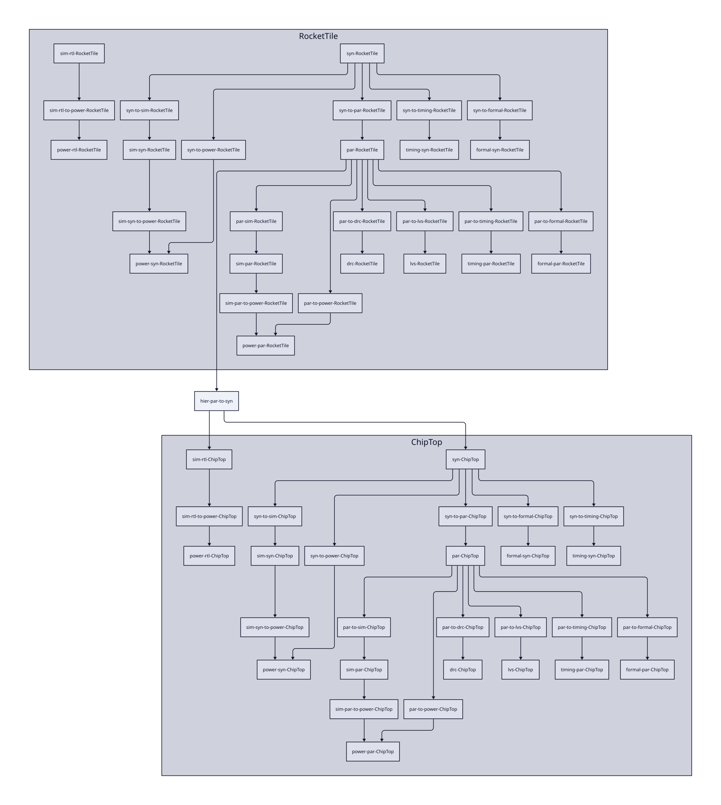

.. _hierarchical:

Hierarchical Hammer Flow
============================================

Hammer supports a bottom-up hierarchical flow. This is beneficial for very large designs to reduce the computing power by partitioning it into submodules, especially if there are many repeated instances of those modules.

Hierarchical Hammer Config
--------------------------

The hierarchical flow is controlled in the ``vlsi.inputs.hierarchical`` namespace. To specify hierarchical mode, you must specify the following keys. In this example, we have our top module set as ``ChipTop``, with a submodule ``ModuleA`` and another submodule ``ModuleAA`` below that (these are names of Verilog modules).

.. code-block:: yaml

    vlsi.inputs.hierarchical:
      mode: hierarchical
      top_module: ChipTop
      config_source: manual
      manual_modules:
      - ChipTop:
        - ModuleA
      - ModuleA:
        - ModuleAA
      constraints:
      - ChipTop:
          vlsi.core...
          vlsi.inputs...
      - ModuleA:
          vlsi.core...
          vlsi.inputs...
      - ModuleAA:
          vlsi.core...
          vlsi.inputs...

Note how the configuration specific to each module in ``vlsi.inputs.hierarchical.constraints`` appears like they would in a flat flow. This means you can apply meta directives to them as normal, as long as the references are in the same parent dictionary (i.e., key = module name).
If you have constraints for the same module in multiple files, you can use ``vlsi.inputs.hierarchical.constraints_meta: append`` and the constraints will be combined properly.

.. note::
    In a bottom-up hierarchical flow, submodule instances must have ``type: hardmacro`` in ``vlsi.inputs.placement_constraints`` because they are hardened from below.

Special considerations for legacy support:

* If each module's ``constraints`` is a list of dicts with a single key/value pair, meta actions are not supported and the entire project configuration must be specified in a single file.

* If placement constraints are specified with ``vlsi.inputs.hierarchical.manual_placement_constraints``, all of a given module's placement constraints must be specified in a single file.

Flow Management and Actions
---------------------------

Based on the structure in ``vlsi.inputs.hierarchical.manual_modules``, Hammer constructs a hierarchical flow graph of dependencies. In this particular example, synthesis and place-and-route of ``ModuleAA`` will happen first. Synthesis of ``ModuleA`` will then depend on the place-and-route output of ``ModuleAA``, and so forth.

These are enumerated in the auto-generated Makefile, ``hammer.d``, which is placed in the directory pointed to by the ``--obj_dir`` command line flag when the ``build`` action is run (``make buildfile`` in Chipyard). This action must be run BEFORE executing your flow. If you adjust the hierarchy, you must re-run this action.

To perform a flow action (syn, par, etc.) for a module using the auto-generated Makefile, the name of the action is appended with the module name. For example, the generated Make target for synthesis of ``ModuleA`` is ``syn-ModuleA``. A graphical example of the auto-generated dependency graph with ``RocketTile`` under a ``ChipTop`` is shown below:

The auto-generated Makefile also has ``redo-`` targets corresponding to each generated action, e.g. ``redo-syn-ModuleA``. These targets break the dependency graph and allow you to re-run any action with new input configuration without forcing the flow to re-run from the beginning of the graph.

.. note::
    In SledgeHammer, set ``vlsi.core.build_system: sledgehammer`` and the same ``build`` action also writes and registers an Airflow DAG with one ``module_<name>`` task group per module.
    Run it from the vlsi directory with ``sledgehammer buildfile``, which runs ``make buildfile`` underneath (``make build`` when the Makefile has a ``build`` rule and no ``buildfile`` rule), and rerun it whenever you adjust the hierarchy.
    Run a target by its name from the same directory, for example ``sledgehammer syn-ModuleA`` (the same as ``sledgehammer run syn --module ModuleA``), and the DAG first runs the stages that target depends on, including those of the child modules.
    Unlike the Make ``redo-`` targets, ``sledgehammer redo-syn-ModuleA`` keeps those dependencies and forces only ``syn`` of ``ModuleA`` to rerun.
    See `CLI_REFERENCE.md <https://github.com/lawrencejrhee/hammer/blob/master/readme_documents/CLI_REFERENCE.md>`_.

Cadence Implementation
----------------------

Currently, the hierarchical flow is implemented with the Cadence plugin using its Interface Logic Model (ILM) methodology. At the end of each submodule's place-and-route, an ILM is written as the hardened macro, which contains an abstracted view of its design and timing models only up to the first sequential element.

ILMs are similar to LEFs and LIBs for traditional hard macros, except that the interface logic is included in all views. This means that at higher levels of hierarchy, the ILM instances can be flattened at certain steps, such as those that perform timing analysis on the entire design, resulting in a more accurate picture of timing than a normal LIB would afford.

Tips for Constraining Hierarchical Modules
------------------------------------------

In a bottom-up hierarchical flow, it is important to remember that submodules do not know the environment in which they will be placed. This means:

* At minimum, the pins must be placed on the correct edges of the submodule on metal layers that are accessible in the parent level. Depending on the technology, this may interfere with things like power straps near the edge, so custom obstructions may be necessary. If fixed IOs are placed in submodules (e.g. bumps), then in the parent level, those pins must be promoted up using the ``preplaced: true`` option in the pin assignment.

* Clocks should be constrained more tightly for a submodule compared to its parent to account for extra clock insertion delay, jitter, and skew at increasingly higher levels of hierarchy. Otherwise, you may run into surprise timing violations in submodule instances even if those passed timing in isolation.

* You may need to specify pin delays ``vlsi.inputs.delays`` for many pins to optimize the partitioning of sequential signals that cross the submodule boundary. By default, without pin delay constraints, the input and output delay are constrained to be coincident with its related clock arrival at the module boundary.

* Custom SDC constraints that originate from a higher level (e.g. false paths from async inputs) need to be specified in submodules as well.

* Custom CPFs will need to be written if differently-named power nets need to be globally connected between submodules. Similarly, hierarchical flow with custom CPFs can also be used to fake a multi-power domain topology until Hammer properly supports this feature.

Special Notes & Limitations
---------------------------

#. Hammer IR keys specified at the root level (i.e. outside of ``vlsi.inputs.hierarchical.constraints``) are overridden by the corresponding submodule constraints. Generally, to avoid confusion, it is recommended to specify all constraints module-by-module with ``vlsi.inputs.hierarchical.constraints``.

#. Most Hammer APIs are not yet intelligent enough to constrain across hierarchical boundaries. For example:

    * The power straps API is unable to pitch match power straps based on legalized placement of submodule instances or vice versa.

    * The pin placement API does not match the placement of pins that may face each other in two adjacent submodule instances. You will need to either manually place the pins yourself or ensure a sufficient routing channel between the instances at the parent level.

#. Hammer does not support running separate decks for submodule DRC and LVS. Technology plugins may need to be written with Makefiles and/or technology-specific options that will implement different checks for submodules vs. the top level.

.. note::
    In SledgeHammer, the dependency check that skips unchanged stages keeps one ``master_database.json`` per ``--obj_dir`` and tracks each stage by name, not by module.
    Each module's ``syn`` is therefore compared with whichever module ran ``syn`` last, so in a hierarchical flow a module's stage usually reruns, or restores its result from the PD cache, even when nothing in that module changed.
