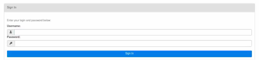
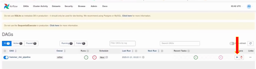
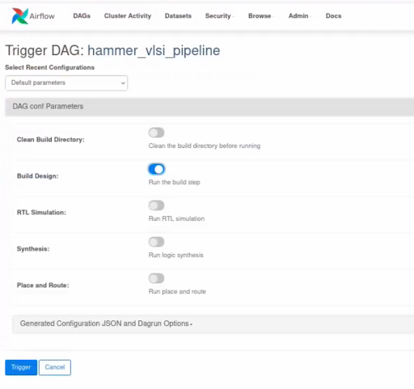

> **DEPRECATED (Airflow 2.x / Poetry era).** This guide describes the pre-SledgeHammer
> setup and no longer matches the code (now uv, Python 3.11, Airflow 3.1, LDAP + 2FA).
> Current documentation lives in [readme_documents/](../../readme_documents/), starting
> with [WORKSPACE_SETUP.md](../../readme_documents/WORKSPACE_SETUP.md).

For each user running their own airflow standalone server


1. ssh [username@bwrcix-3.eecs.berkeley.edu](mailto:username@bwrcix-3.eecs.berkeley.edu)
2. Tool installation
    1. Conda
        1. Install Miniforge/conda

            ```
            wget -O Miniforge3.sh "https://github.com/conda-forge/miniforge/releases/latest/download/Miniforge3-$(uname)-$(uname -m).sh"
            bash Miniforge3.sh -p "/bwrcq/C/username/conda"
            ```


        2. Make sure the followings are in ~/.bashrc to have conda initialized 

            ```
             # >>> conda initialize >>>
             # !! Contents within this block are managed by 'conda init' !!
             __conda_setup="$('/bwrcq/C/username/conda/bin/conda' 'shell.bash' 'hook' 2> /dev/null)"
             if [ $? -eq 0 ]; then
                 eval "$__conda_setup"
             else
                 if [ -f "/bwrcq/C/username/conda/etc/profile.d/conda.sh" ]; then
                     . "/bwrcq/C/username/conda/etc/profile.d/conda.sh"
                 else
                     export PATH="/bwrcq/C/username/conda/bin:$PATH"
                 fi
             fi
             unset __conda_setup
             # <<< conda initialize <<<
            ```


    2. Setup poetry 1.8.3
        3. Vim ~/setup.sh
        4. Add the followings to this setup.sh and save

            ```
            curl -sSL https://install.python-poetry.org | python3 - --version 1.8.3

            poetry config virtualenvs.in-project true
            poetry install

            poetry shell
            ```


    3. Airflow
        5. Vim ~/airflow.sh
        6. Add the followings to this airflow.sh and run it

            ```
            AIRFLOW_VERSION=2.9.0

            # Extract the version of Python you have installed. If you're currently using a Python version that is not supported by Airflow, you may want to set this manually.
            # See above for supported versions.
            PYTHON_VERSION="$(python -c 'import sys; print(f"{sys.version_info.major}.{sys.version_info.minor}")')"

            CONSTRAINT_URL="https://raw.githubusercontent.com/apache/airflow/constraints-${AIRFLOW_VERSION}/constraints-${PYTHON_VERSION}.txt"
            # For example this would install 2.10.2 with python 3.8: https://raw.githubusercontent.com/apache/airflow/constraints-2.10.2/constraints-3.8.txt

            pip install "apache-airflow==${AIRFLOW_VERSION}" --constraint "${CONSTRAINT_URL}"
            ```


3. In /bwrcq/C/username/: source ~/.bashrc
4. In /bwrcq/C/username: source setup.sh ← This is from step &lt;2b>
5. [only first time, creates an account] 

    In /bwrcq/C/username/hammer/e2e: airflow users create -r User [-u USERNAME] [-e EMAIL] [-f FIRSTNAME] [-l LASTNAME] [-p PASSWORD]

6. In /bwrcq/C/username/hammer/e2e: airflow standalone
7. Open on browser: bwrcix-3.eecs.berkeley.edu:&lt;ip_port>/home
    4. Ip_port is default at 8080 and can be configured in ~/airflow/airflow.cfg

Common problems


* Incompatible versions:
    * Working as of 2/17/25: Please refer to installation step &lt;2b> and &lt;2c> for adjustments on poetry, python and airflow version
        * Python 3.8.12
        * Poetry 1.8.3
        * Hammer version: 3.9.4
        * Airflow 2.9.0 (Git Version: .release:50f22ffe9150e93f7fc08a9dc8a48880daad374b)
* Sim-rtl not working: 
    * cp /bwrcq/C/isabellehsu/eecs151_labs/hammer_cache_files/* /bwrcq/C/isabellehsu/hammer/e2e/build-sky130-cm/gcd/tech-sky130-cache/

To run flow:


1. Setup the DAG
    1. Pull the latest airflow branch from Hammer github repo
    2. Make sure the airflow is pointing to the sledgehammer DAG by 
        1. Open ~/airflow/airflow.cfg
        2. Edit the variable “dags_folder”, make sure it points to hammer/shell directory inside your new hammer git pulled directory
2. Login with credentials entered when the user was created




3. Press the ▶ symbol to trigger the hammer_vlsi_pipeline DAG (Directly Acyclic Graph) 




4. This should popup automatically. Choose what you want to run. Then click “Trigger” on the bottom left.

    



## Giving a stage its own config files

By default every stage reads every `-p` config of the build call. When two files set the same keys, such as an
RTL and a gate-level simulation config, the last one wins for every stage. To give a file to only some stages,
name it under `vlsi.core.stage_configs.<stage>`, in any file passed with `-p` at build:

```yaml
vlsi.core.stage_configs.sim_rtl: ["sim-rtl.yml"]
vlsi.core.stage_configs.sim_rtl_meta: prependlocal
vlsi.core.stage_configs.sim_syn: ["sim-gl-syn.yml"]
vlsi.core.stage_configs.sim_syn_meta: prependlocal
vlsi.core.stage_configs.sim_par: ["sim-gl-par.yml"]
vlsi.core.stage_configs.sim_par_meta: prependlocal
```

A file named here is taken out of every other stage's configs, whether or not it is also a `-p` of the build call.
Its stages read it after the project configs and before any generated input JSON. `<stage>` is a task of the
generated DAG (`sim_rtl`, `syn`, `syn_to_sim`, `sim_syn`, `par_to_lvs`, `lvs`, ...; the full list is under
`vlsi.core.stage_configs` in `defaults.yml`). Rebuild the DAG after changing these keys. The same files are used by
the targets in `hammer.d`.

## Running test programs on the compiled simulator

A sim stage compiles the simulator. To also run test programs on it, describe them under `sim.tests` and select
them when you run the stage:

```yaml
sim.inputs.execute_sim: false
sim.tests.run_flags: ["-q", "+ntb_random_seed_automatic"]
sim.tests.suites:
  - name: asm
    tests: [add, addi, beq]
    program: "tests/asm/{test}.hex"
    prepare: ["make -C tests/asm"]
    flags: ["+verbose", "+max-cycles=50000", "+loadmem={program}"]
    pass_regex: '\*\*\* PASSED \*\*\*'
```

```
sledgehammer run sim-rtl --tests asm:all
sledgehammer run sim-par --tests asm:add,addi
sledgehammer run sim-rtl sim-syn --rtl-tests asm:all --rtl-tests bmark:all --syn-tests bmark:fib
```

`--tests` selects the same tests for every sim stage named in the run. `--rtl-tests`, `--syn-tests` and
`--par-tests` select them for one stage, which then ignores `--tests`. Each needs its stage in the run.

In the DAG, the tests run in their own task after the stage compiles: `sim_rtl_tests`, `sim_syn_tests` and
`sim_par_tests`. A failing test turns only that task red; the compile task and the power tasks, which need only the
compiled simulator, are not affected. The task's log has a line per test and a summary. In the trigger form, the
"Sim tests (for sim_rtl, sim_syn, sim_par)" panel has one field per sim stage, one selection per line. A field is
used only when its stage is ticked; leave it empty to only compile.

Without Airflow, pass `--sim_tests` to the `sim` action, or run the `sim-tests` action on an already compiled
simulator with `-p <run directory>/sim-output-full.json --sim_rundir <run directory>`. With the targets in
`hammer.d`, use a `redo-` target, e.g. `make redo-sim-rtl HAMMER_EXTRA_ARGS="--sim_tests asm:all"`: plain
`make sim-rtl` does nothing while the sim is up to date. A project's own Makefile targets may not pass
`HAMMER_EXTRA_ARGS` at all.

Each test's stderr is in `<output>/<suite>/<test>.out`, its stdout in `<test>.log`, and every verdict in
`<output>/results.json`. `<output>` is `<run directory>/tests`, or a subdirectory of `sim.tests.output_dir`. A test
passes if the simulator exits 0 and `pass_regex` matches its stderr or stdout. All selected tests run even after a
failure, and the tests task then fails if any test did not pass. Tests run one at a time unless
`sim.inputs.parallel_runs` is raised. They run on the machine running the sim action, not through `sim.submit`, and
only with the VCS plugin so far. A design with no `sim.tests.suites` is not affected.

With `sim.tests` set and `execute_sim: false`, the compiled simulator is cached like other stages, so an unchanged
design does not compile again (`--force` recompiles). **Test results are never cached**: simulations commonly draw
a new random seed each run, and a stored pass would not be a new sample.
